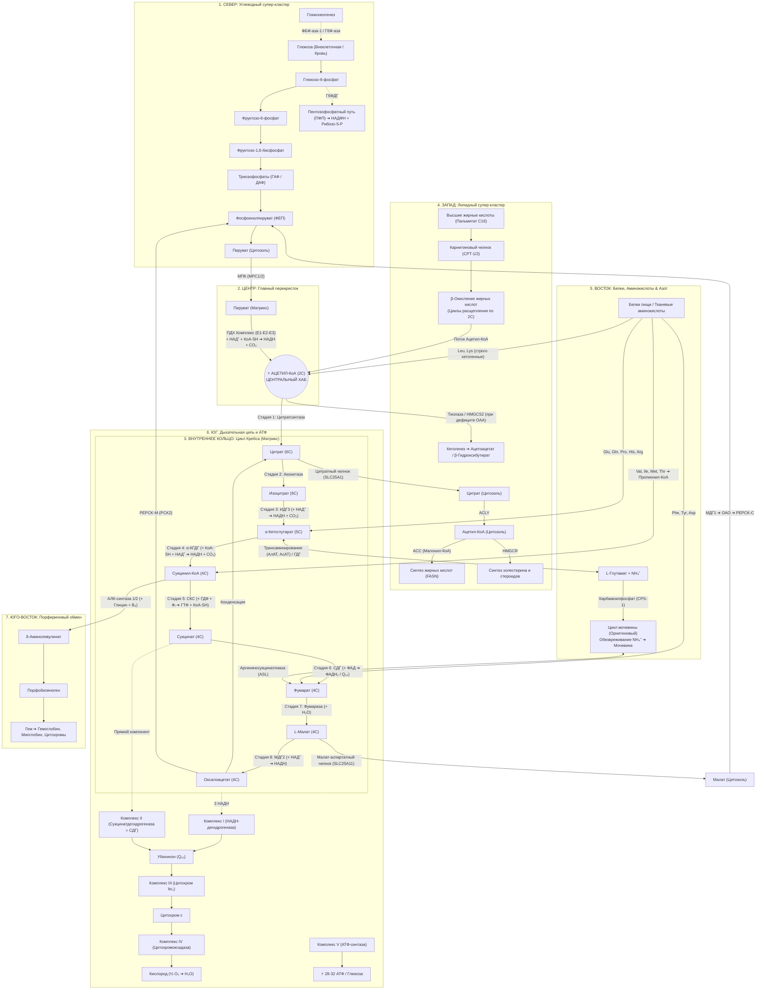

# Архитектурный план глобальной карты метаболизма человека (Metabolic Atlas)
## Концепция «Metabolic Solar System» с центральным хабом Ацетил-КоА

> **Назначение документа**: Данный документ содержит спецификацию топологии, математической системы координат, секторального зонирования и межпутевых перекрёстков глобальной метаболической карты. Документ предназначен для передачи в контекст AI-ассистента и команды разработки для поэтапной реализации фронтенда и графа данных.

---

## 1. Концепция и философия визуализации

В биохимии человека **Ацетил-КоА ($C_2$)** выступает главным метаболическим перекрёстком клетки:
1. **Катаболическая конвергенция**: расщепление углеводов (через ПДХ), липидов (через $\beta$-окисление) и кетогенных аминокислот сходится в образование Ацетил-КоА.
2. **Анаболическая дивергенция**: избыток Ацетил-КоА направляется на синтез жирных кислот, холестерина, стероидов и кетоновых тел.
3. **Энергетическая интеграция**: Ацетил-КоА является топливом для Цикла Кребса (ЦТК), генерирующего восстановительные эквиваленты (НАДН, ФАДН₂) для дыхательной цепи (OxPhos).

### Архитектурная парадигма: Polar Metabolic Universe
Карта строится по **полярно-секторальной топологии**:
- **Центральное ядро (Полюс $(0, 0)$)**: Хаб **Ацетил-КоА**.
- **Внутренняя орбита ($R \approx 450 - 650\text{px}$)**: **Цикл трикарбоновых кислот (ЦТК)** в виде замкнутого 8-стадийного эллипса/кольца.
- **Внешние лучевые секторы (Радиальные метаболические континенты)**: отходят от центра и кольца ЦТК в строго определённых направлениях, отражающих физиологическую и биохимическую логику.

---

## 2. Глобальная система координат и секторальное зонирование

Виртуальный холст карты определяется глобальной координатной сеткой **$3200 \times 3200\text{px}$**, где центр системы координат $(X_0, Y_0) = (1600, 1600)$:

```
                         [СЕВЕР: УГЛЕВОДЫ]
                    Глюкоза ➔ Гликолиз ➔ Пируват
                                  │
                                  ▼ (ПДХ)
         [ЗАПАД: ЛИПИДЫ]          │          [ВОСТОК: БЕЛКИ И АЗОТ]
     Жирные кислоты (FAO) ──► ⚡ Ацетил-КоА ◄── Кетогенные АК (Leu, Lys)
     Кетогенез ◄───────────────  (1600, 1600)  ──► Орнитиновый цикл (Мочевина)
     Липогенез ◄── (Цитрат)       │
                                  ▼
                            [КОЛЬЦО ЦТК]
                       (ОАО ➔ Цит ➔ α-КГ ➔ Сук)
                                  │
                                  ▼
                         [ЮГ: ДЫХАНИЕ И АТФ]
                      OxPhos (Комплексы I - V)
```

### Спецификация секторов:

| Сектор | Направление (Угол) | Метаболические пути | Ключевые узлы сопряжения с центром/ЦТК | Компартмент |
| :--- | :--- | :--- | :--- | :--- |
| **Центр** | **Ядро $(0^\circ, R=0)$** | **Ацетил-КоА Hub** | Координата $(1600, 1600)$, пульсирующий узел-маяк | Матрикс митохондрий |
| **Внутреннее кольцо** | **Орбита $R \approx 500\text{px}$** | **Цикл Кребса (ЦТК)** | Стадия 1 (Цитратсинтаза) принимает Ацетил-КоА; Стадии 3, 4, 6, 8 генерируют коферменты | Матрикс митохондрий |
| **Север (North)** | **$12:00$ ($\theta \approx -90^\circ$)** | **Гликолиз, Глюконеогенез, ПФП** | Вход через ПДХ-комплекс (Пируват $\rightarrow$ Ацетил-КоА); Выход через PEPCK-M (ОАО $\rightarrow$ ФЕП) | Цитозоль / Митохондрия |
| **Запад (West)** | **$9:00$ ($\theta \approx 180^\circ$)** | **$\beta$-Окисление, Кетогенез, Липогенез** | $\beta$-окисление вливает Ацетил-КоА в хаб; Кетогенез забирает Ацетил-КоА; Липогенез забирает Цитрат | Митохондрия / Цитозоль |
| **Восток (East)** | **$3:00$ ($\theta \approx 0^\circ$)** | **Обмен аминокислот, Цикл мочевины** | Вход кетогенных АК в Ацетил-КоА; Трансаминирование в $\alpha$-КГ; Вход разветвленных АК в Сукцинил-КоА; Фумаратный шунт мочевины | Митохондрия / Цитозоль (печень) |
| **Юг (South)** | **$6:00$ ($\theta \approx +90^\circ$)** | **Дыхательная цепь (OxPhos), АТФ** | Комплекс II (СДГ) физически совпадает со стадией 6 ЦТК; Прием НАДН от стадий 3, 4, 8 | Внутренняя мембрана и кристы |
| **Юго-Восток (SE)** | **$5:00$ ($\theta \approx +45^\circ$)** | **Биосинтез гема и порфиринов** | Ответвление от Сукцинил-КоА через $\delta$-АЛК-синтазу 1/2 | Митохондрия / Цитозоль |

---

## 3. Детальная карта межпутевых связей (Connectome & Shunts)



---

## 4. Спецификация уровней детализации интерфейса (LOD — Levels of Detail)

Для сохранения плавной производительности SVG-рендеринга и чистоты восприятия применяется 3-уровневая система LOD:

### LOD 1: Macro View (Zoom 15% – 45%) — «Глобальная карта метаболизма»
- **Визуализация**:
  - Ацетил-КоА в центре выделен сияющим акцентным маркером (`#10B981`, pulsing glow).
  - Метаболические пути отображаются крупными мягкими градиентными областями («континентами»): *Углеводы (Оранжевый)*, *Липиды (Фиолетовый)*, *ЦТК (Изумрудный)*, *Аминокислоты (Розовый)*, *OxPhos (Синий)*.
  - Между путями анимированы **метаболические супер-магистрали** (толстые линии 4–6px с динамическими частицами потока).
- **Интерактивность**:
  - Клик по любому сектору или перекрестку плавно масштабирует (Zoom & Pan) камеру к выбранному пути.

### LOD 2: Meso View (Zoom 45% – 90%) — «Топология метаболического пути»
- **Визуализация**:
  - Внутри секторов проявляются цепочки метаболитов в виде карточек с названиями и формулами.
  - Отображаются направленные стрелки реакций с номерами этапов.
  - Отчетливо видны точки входа и выхода (Crossroad Badges: `ПДХ`, `Цитратный челнок`, `Трансаминирование`, `Кребсовский велосипед`).
- **Интерактивность**:
  - Наведение на метаболит подсвечивает все реакции, где он участвует в других путях (Cross-pathway highlighting).

### LOD 3: Micro View (Zoom 90% – 250%) — «Биохимическая лаборатория»
- **Визуализация**:
  - Полные 2D скелетные и структурные химические формулы.
  - Коферментные дуги Безье с чипами коферментов (`+ НАД⁺`, `НАДН + H⁺`, `+ КоА-SH`, `+ Фᵢ`).
  - Ферментные узлы с названиями ферментов, генами (`CS`, `ACO2`, `IDH3A`, `OGDH`, `SUCLG1`, `SDHA`, `FH`, `MDH2`) и шифрами КФ/EC.
  - Аллостерические метки регуляции: зеленые круги с `+` (активаторы) и красные с `−` (ингибиторы).
- **Интерактивность**:
  - Клик открывает детальный Контекстный Инспектор (Context Inspector) со свойствами, механизмами и ссылками на ChEBI / Rhea / PubChem.

---

## 5. Модель данных для масштабирования (Архитектурные контракты)

Для поддержки мульти-путевого графа архитектура клиента расширяется следующими интерфейсами:

```typescript
export interface SectorLayoutConfig {
  sectorId: string;
  nameRu: string;
  nameEn: string;
  centerAngleRad: number;
  radiusMin: number;
  radiusMax: number;
  themeColor: string;
  boundingPoly: { x: number; y: number }[];
}

export interface PathwaySuperHighway {
  id: string;
  sourcePathwayId: string;
  targetPathwayId: string;
  sourceMetaboliteCode: string;
  targetMetaboliteCode: string;
  pathData: string; // Cubic / Quad Bezier
  carbonFlux: string; // e.g., '3C ➔ 2C'
  isAnabolic: boolean;
  isCatabolic: boolean;
}

export interface GlobalMetabolicCanvasState {
  lodLevel: 1 | 2 | 3;
  activeSectorId: string | 'ALL';
  focusMetaboliteCode: string | null;
  camera: { x: number; y: number; zoom: number };
}
```

---

## 6. Рекомендованный план поэтапной реализации

1. **Фаза 1: Макро-режим «Все пути» (Обзор)**
   - Добавление опции `ALL` в верхнем меню с центрированием камеры на Ацетил-КоА $(1600, 1600)$.
   - Отрисовка контурных зон секторов и супер-магистралей в текущем SVG-холсте.
2. **Фаза 2: Северный сектор — Гликолиз и ПДХ**
   - Добавление реакций гликолиза (10 стадий) от Глюкозы до Пирувата в координатах $Y \in [400, 1200]$.
   - Вертикальный вектор ПДХ прямо в Ацетил-КоА.
3. **Фаза 3: Западный сектор — $\beta$-Окисление и Липогенез**
   - Спираль катаболизма жирных кислот слева от Ацетил-КоА.
   - Вектор Цитратного челнока из ЦТК в цитозольный синтез жиров.
4. **Фаза 4: Восточный сектор — Аминокислоты и Цикл мочевины**
   - Сетка трансаминирования справа от ЦТК со стыковкой к $\alpha$-КГ и ОАО.
   - Цикл мочевины с фумаратным шунтом к стадии 7 ЦТК.
5. **Фаза 5: Южный сектор — OxPhos (Дыхательная цепь)**
   - Размещение крист митохондрий снизу от ЦТК со стыковкой СДГ (Комплекс II) и переносом НАДН от дегидрогеназ.

---

## 7. Как переиспользовать этот документ в новом окне чата

В новом окне с чистым контекстом достаточно отправить сообщение следующего вида:

> *"Привет! Мы разрабатываем Metabolic Atlas. Ознакомься с документом `docs/architecture/METABOLIC_MAP_GLOBAL_LAYOUT.md`. Наша цель — продолжать поэтапную реализацию глобальной карты метаболизма с хабом Ацетил-КоА в центре согласно этому плану. Сейчас мы переходим к реализации [Фазы N / конкретной задачи]. Проанализируй состояние проекта и предложи план действий."*

