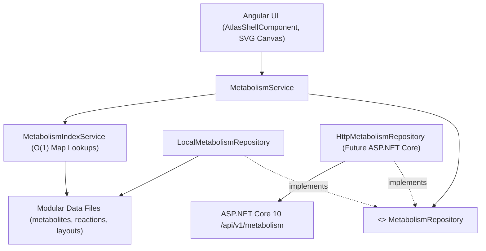

# Архитектурная спецификация системы данных метаболической карты (Metabolic Atlas)

## 1. Введение и назначение

Данный документ описывает целевую архитектуру модульной системы данных метаболической карты человека проекта **Metabolic Atlas**.
Архитектура спроектирована по принципам Clean Architecture и Domain-Driven Design (DDD) с разделением на три независимых слоя:
1. **Биологический домен (Biological Domain Layer)**
2. **Граф и визуализация (Graph & Visualization Layer)**
3. **Слой доступа к данным (Data Access Layer)**

Система обеспечивает 100% сохранение биохимических данных, детерминированную визуализацию на SVG-холсте и прозрачную подготовку к будущей интеграции с бэкендом на **ASP.NET Core 10 / .NET 10**.

---

## 2. Архитектура модулей и назначение директорий

```text
client/src/app/
├── core/
│   └── metabolism/                       # Ядро метаболического домена (бизнес-логика и контракты)
│       ├── models/                       # Чистые TypeScript-интерфейсы
│       │   ├── metabolite.model.ts       # Биологические метаболиты и участие в путях
│       │   ├── reaction.model.ts         # Биохимические реакции, кинетика, регуляция
│       │   ├── layout.model.ts           # Экранные координаты, размеры, SVG-траектории
│       │   ├── navigation.model.ts       # Секторы, перекрёстки, супер-магистрали, камера
│       │   ├── canvas-view.model.ts      # Композитные типы (HumanMetaboliteNode, HumanReactionArrow)
│       │   └── index.ts                  # Баррель типов
│       │
│       ├── repositories/                 # Слой репозиториев (Repository Pattern)
│       │   ├── metabolism.repository.ts  # Абстрактный контракт доступа к данным (Observable API)
│       │   └── local-metabolism.repository.ts # In-memory реализация репозитория
│       │
│       ├── services/                     # Фасадные сервисы и графовые индексы
│       │   ├── metabolism.service.ts     # Основной сервис доступа для Angular-компонентов
│       │   └── metabolism-index.service.ts # O(1) индексы для мгновенного поиска и связей
│       │
│       └── index.ts                      # Корневой экспорт ядра метаболизма
│
├── data/
│   └── metabolism/                       # Физическое модульное хранилище данных
│       ├── metabolites/                  # Данные метаболитов
│       │   ├── human-metabolites.data.ts # 36 ключевых метаболитов человека (чистая биохимия)
│       │   ├── cofactor-metabolites.data.ts # 17 коферментов и нуклеотидов (чистая биохимия)
│       │   └── index.ts
│       │
│       ├── reactions/                    # Модули биохимических реакций по метаболическим ветвям
│       │   ├── carbohydrates/            # Углеводный обмен (25 реакций)
│       │   │   ├── glycolysis.reactions.ts         # 10 реакций гликолиза (R_HK ... R_PK)
│       │   │   ├── galactose.reactions.ts          # 5 реакций пути Лелуара (R_GALK1 ... R_LCT)
│       │   │   ├── fructose.reactions.ts           # 5 реакций фруктолиза (R_KHK ... R_SI)
│       │   │   ├── glycogen.reactions.ts           # 3 реакции метаболизма гликогена
│       │   │   ├── pyruvate-transport.reactions.ts # 2 реакции: MPC1/2 и комплекс ПДХ
│       │   │   └── index.ts
│       │   ├── energy/                   # Биоэнергетика (12 реакций)
│       │   │   ├── tca.reactions.ts                # 8 реакций цикла Кребса (R_CS ... R_MDH)
│       │   │   ├── oxphos.reactions.ts             # 4 реакции дыхательной цепи (Комплексы I, III, IV, V)
│       │   │   └── index.ts
│       │   └── index.ts                  # Экспорт всех 37 реакций
│       │
│       ├── navigation/                   # Навигационные сущности карты
│       │   ├── crossroads.data.ts        # 6 межпутевых шлюзов (Crossroads)
│       │   ├── super-highways.data.ts    # 8 углеродных супер-магистралей между путями
│       │   └── index.ts
│       │
│       ├── visualization/                # Экранная геометрия и векторная графика
│       │   ├── metabolite-layouts.data.ts# SVG-структуры и координаты 53 метаболитов
│       │   ├── reaction-layouts.data.ts  # Геометрия стрелок, ветвей и дуг 37 реакций
│       │   ├── sectors.data.ts           # Конфигурация 5 радиальных секторов
│       │   └── index.ts
│       │
│       ├── hydration.ts                  # Чистые функции связывания биохимии и разметки
│       ├── metabolism-data.spec.ts       # Автоматические тесты целостности графа данных
│       └── index.ts                      # Центральный реэкспорт готовых датасетов
│
└── features/atlas/
    └── atlas-data.ts                     # Фасад обратной совместимости для старых импортов
```

---

## 3. Описание моделей данных

### 3.1. Biological Domain Layer (Слой A)

#### `BiologicalMetabolite` (`core/metabolism/models/metabolite.model.ts`)
Инкапсулирует биологическую сущность химического вещества:
- `id`: глобально уникальный неизменяемый UUID v4.
- `code`: буквенно-цифровой идентификатор (например, `MET_GLUCOSE`, `MET_CITRATE`).
- `nameRu`, `nameEn`: канонические русские и английские названия.
- `abbrevRu`, `abbrevEn`: общепринятые сокращения (например, «Г6Ф», «G6P»).
- `formula`: эмпирическая формула вещества.
- `carbons`, `carbonsEn`: количество и распределение атомов углерода (например, «6C»).
- `smiles`: каноническая строка SMILES.
- `chebi`: идентификатор базы ChEBI.
- `inchiKey`: уникальный 27-символьный хэш InChIKey.
- `descriptionRu`, `descriptionEn`: расширенное биохимическое описание метаболита.
- `synonymsRu`, `synonymsEn`: альтернативные номенклатурные синонимы.
- `compartmentRu`, `compartmentEn`: клеточная локализация (цитозоль, матрикс митохондрий и др.).
- `isCofactor`: признак малого кофермента/нуклеотида.
- `isHub`: признак узлового метаболического перекрёстка (например, `MET_ACETYL_COA`).
- `pathwaysRu`: массив участия в метаболических путях (`PathwayParticipation[]`).

#### `BiologicalReaction` (`core/metabolism/models/reaction.model.ts`)
Инкапсулирует биохимическую реакцию и катализ:
- `id`: уникальный UUID v4.
- `code`: уникальный код реакции (`R_HK`, `R_CS`, `R_ETC_CI`).
- `stepNumber`: номер шага в метаболическом пути.
- `pathwayCode`: код основного пути (`PW-GLYCOLISIS`, `PW-TCA-CYCLE` и др.).
- `sourceMetaboliteId`, `targetMetaboliteId`: UUID ключевых субстрата и продукта.
- `secondarySourceId`, `secondaryTargetId`: UUID дополнительных участников для мультисубстратных/мультипродуктных реакций.
- `enzymeRu`, `enzymeEn`, `enzymeShort`: название и сокращение катализирующего фермента.
- `ecNumber`: классификационный номер фермента по Enzyme Commission (EC).
- `gene`: кодирующие гены человека по номенклатуре HGNC.
- `uniprotId`: идентификаторы в белковой базе данных UniProt.
- `isReversible`: термодинамическая обратимость в физиологических условиях.
- `deltaG0`: стандартная свободная энергия Гиббса $\Delta G^{\circ\prime}$ (кДж/моль).
- `substrates`, `products`: стехиометрический состав участников реакции.
- `activatorsRu`, `inhibitorsRu`: аллостерические и гормональные регуляторы.
- `mechanismRu`: молекулярный механизм реакции.
- `energyBalanceRu`, `netAtpYieldRu`: вклад в энергетический баланс клетки.
- `clinicalNoteRu`: клиническое значение и связанные генетические патологии.

---

### 3.2. Graph & Visualization Layer (Слой B)

#### `MetaboliteLayout` (`core/metabolism/models/layout.model.ts`)
- `metaboliteId`: внешний ключ к `BiologicalMetabolite.id`.
- `x`, `y`: координаты верхнего левого угла плашки на глобальном холсте ($3200 \times 3200\text{px}$).
- `width`, `height`: размеры плашки узла. Для кофакторов, не имеющих плитки на холсте, установлены в $0$.
- `color`: акцентный шестнадцатеричный цвет плашки.
- `skeletalSvg`, `structureSvg`: векторная скелетная формула и химическая структура в SVG.

#### `ReactionLayout` (`core/metabolism/models/layout.model.ts`)
- `reactionId`: внешний ключ к `BiologicalReaction.id`.
- `pathData`: основная SVG-траектория реакции (`M ... C ... L ...`).
- `secondaryPathData`: траектория для альтернативного направления или ответвления.
- `tooltipX`, `tooltipY`: координаты якорной точки отображения бейджа фермента и всплывающей карточки.
- `junction`: координаты и маркер узла слияния/расхождения потоков (`ReactionJunction`).
- `branches`: массив независимых SVG-ветвей для разветвлённых реакций (`ReactionBranch[]`).
- `cofactorArc`: геометрия кофакторной дуги с пресетом и точками входа/выхода (`ReactionCofactorArc`).

#### `Canvas View Models` (`core/metabolism/models/canvas-view.model.ts`)
- `HumanMetaboliteNode = BiologicalMetabolite & MetaboliteLayout`
- `HumanReactionArrow = BiologicalReaction & ReactionLayout`

Гидратация выполняется детерминированно функциями `hydrateMetabolite` и `hydrateReaction` в `hydration.ts`.

---

## 4. Слой доступа к данным (Layer C: Data Access)



### Принцип работы
1. `AtlasShellComponent` и вспомогательные компоненты инжектируют `MetabolismService`.
2. Компоненты получают доступ к:
   - Синхронным коллекциям `service.canvasMetabolites`, `service.reactions` для быстрых циклов рендеринга `@for`.
   - Реактивным потокам `getMetabolites$()`, `getReactions$()`, типизированным как `Observable<T>`.
   - Методам быстрого поиска `getMetaboliteByCode()`, `getReactionsByPathway()`, `getReactionsForMetabolite()`.
3. `MetabolismIndexService` кэширует внутренние графовые индексы в виде `Map<string, T>` при старте приложения, гарантируя $O(1)$ время отклика при кликах, ховерах и фильтрациях.

---

## 5. Подготовка к будущему ASP.NET Core 10 API

Архитектура готова к подключению серверного API без переработки UI-компонентов:
1. Контракт `MetabolismRepository` полностью абстрагирует происхождение данных.
2. При реализации бэкенда на .NET 10 достаточно реализовать `HttpMetabolismRepository`:
   ```typescript
   @Injectable()
   export class HttpMetabolismRepository implements MetabolismRepository {
     private readonly http = inject(HttpClient);
     private readonly baseUrl = '/api/v1/metabolism';

     getMetabolites(): Observable<BiologicalMetabolite[]> {
       return this.http.get<BiologicalMetabolite[]>(`${this.baseUrl}/metabolites`);
     }
     // ...
   }
   ```
3. Переключение между локальным хранилищем и удалённым API выполняется в `app.config.ts`:
   ```typescript
   { provide: LocalMetabolismRepository, useClass: environment.useHttp ? HttpMetabolismRepository : LocalMetabolismRepository }
   ```

---

## 6. Валидация целостности данных

В проекте развёрнут автоматизированный набор тестов `client/src/app/data/metabolism/metabolism-data.spec.ts` (10 тестов) и `client/src/app/core/metabolism/services/metabolism.service.spec.ts` (6 тестов), гарантирующий:
- Уникальность всех 53 UUID и кодов метаболитов.
- Уникальность всех 37 UUID и кодов реакций.
- Разрешимость всех ссылок субстратов, продуктов и ветвей.
- Валидность геометрических параметров, SVG-разметки и ограничивающих полигонов.
- 100% глубокую эквивалентность данных до и после рефакторинга.
